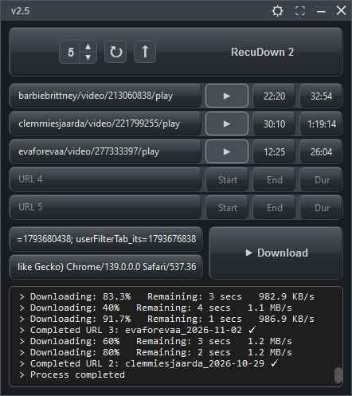
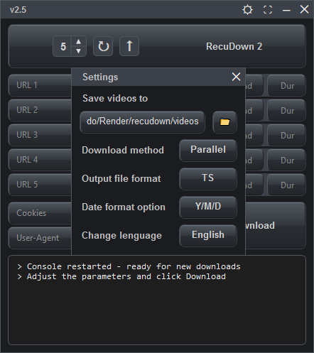
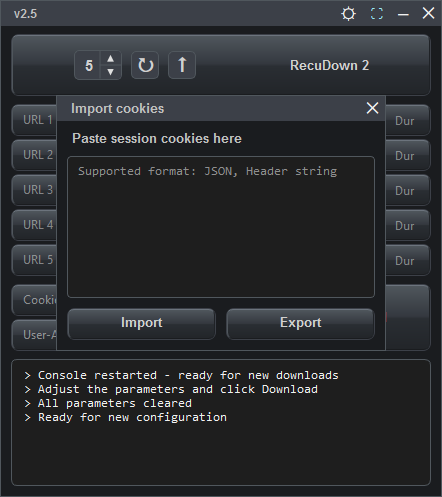

# RecuDown 2
| View 1 | View 2 | View 3 |
| :---: | :---: | :---: |
|  |  |  |

This project is an original user interface built from scratch. It uses the open-source `recu-windows-amd64.exe` engine created by [@baconator696](https://github.com/baconator696) to handle the background downloads.

## Main Features

- **Flexible Download Modes:** Download multiple videos at the same time (Parallel Mode) or one by one in order (Series Mode).
- **Cookie Injection & Extraction (CDP):** Automatically retrieve your session cookies and User-Agent by connecting to your browser via the Chrome DevTools Protocol (CDP). No more manual copy-pasting.
- **Automatic Browser Detection:** On startup, the app searches for Chromium-based browsers (Chrome, Edge, Opera GX, Brave, Vivaldi, etc.) and launches them in debug mode to facilitate logging in.
- **Automatic Video Conversion:** If FFmpeg is installed on your system, the app will automatically convert downloaded `.ts` files to MP4 or MKV without losing quality.
- **Multi-language Support:** Interface fully translated into English, Spanish, Portuguese, and Russian.
- **Date-based Renaming Options:** Automatically organize your files using the Year-Month-Day format (YYYY-MM-DD), Day-Month-Year format (DD-MM-YYYY), or keep the original video name.
- **Automatic Backups:** Saves a history of your last 10 download configurations in a `backup.txt` file, so you never lose your progress.
- **Customizable UI:** Frameless window with an "Always on Top" option, a URL quantity selector, and confirmation sounds for clicks and completed downloads.

## How to Use (Windows)

Because automated executable files (`.exe`) are restricted on GitHub, the pre-compiled version is hosted externally.

1. Download the `App.rar` from this secure link: **[PON_TU_ENLACE_DE_PROTON_DRIVE]**
2. Extract the archive using the password: **`1234`**
3. Run `App.exe`. You don't need to install Python or any additional libraries.
4. *(Optional)* If you have FFmpeg installed, the app will automatically convert the videos for you.

## Compiling from Source (Developers)

If you want to modify the code and compile it yourself, follow these steps. Note: All source code and asset files are located inside the files folder in this repository.

1. Install Python 3.10 or higher.
- **Option A (Web):** Download it from [python.org](https://www.python.org/). **Important:** During installation, make sure to check the box that says **"Add Python to PATH"**.
- **Option B (CMD):** If you have `winget` installed, open CMD and run: `winget install Python.Python.3.10`
2. Download or clone this repository and extract the files into a folder on your PC.
3. Open a Command Prompt (CMD) **inside that folder**.
- *Easy way:* Open the folder in File Explorer, click on the address bar at the top, type `cmd`, and press Enter.
4. **Get the download engine:** Download `recu-windows-amd64.exe` from [@baconator696's repository](https://github.com/baconator696/Recu-Download) and place it in the same folder as your Python files.
5. Install the required Python dependencies:
   `python -m pip install -r requirements.txt`
6. Test the application from source (optional):
   `python RecuDown.py`
7. Build the final executable using PyInstaller. Run this command in Windows CMD:
```
   `pyinstaller --onefile --noconsole ^`
   `--add-binary "recu-windows-amd64.exe;." ^`
   `--add-binary "sound.wav;." ^`
   `--add-binary "tap.wav;." ^`
   `--add-data "icon.ico;." ^`
   `--icon=icon.ico ^`
   `--version-file=version_info.txt ^`
   `--hidden-import=websocket ^`
   `recudown.py`
   ```
*After the compilation finishes, you will find your final `.exe` file inside the newly created `dist` folder.*
## Credits

- **Download Engine:** [@baconator696](https://github.com/baconator696)
- **GUI & Code:** jorminyo2022

## License

Same as the original project.
