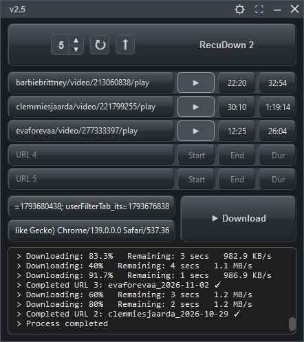
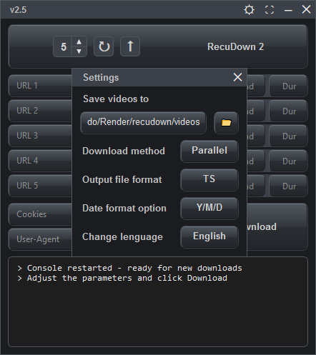
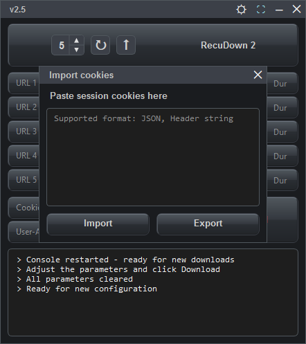

# RecuDown 2
**Leer en:** [English](README.md) | [Español](README_es.md)

| Vista 1 | Vista 2 | Vista 3 |
| :---: | :---: | :---: |
|  |  |  |

Este proyecto consiste en una interfaz de usuario original desarrollada desde cero. Utiliza el motor de código abierto `recu-windows-amd64.exe`, creado por [@baconator696](https://github.com/baconator696), para gestionar las descargas en segundo plano.

## Características principales

- **Modos de descarga flexibles:** Permite descargar varios vídeos simultáneamente (modo paralelo) o uno tras otro (modo en serie).
- **Inyección y extracción de cookies (CDP):** Obtiene automáticamente las cookies de sesión y el *User-Agent* conectándose a tu navegador mediante el protocolo Chrome DevTools (CDP). Olvídate de copiar y pegar manualmente.
- **Detección automática de navegadores:** Al iniciar, la aplicación busca navegadores basados ​​en Chromium (Chrome, Edge, Opera GX, Brave, Vivaldi, etc.) y los ejecuta en modo de depuración para facilitar el inicio de sesión.
- **Conversión automática de vídeos:** Si tienes instalado FFmpeg en tu sistema, la aplicación convertirá automáticamente los archivos `.ts` descargados a formato MP4 o MKV sin pérdida de calidad.
- **Soporte multiidioma:** Interfaz totalmente traducida al inglés, español, portugués y ruso.
- **Opciones de renombrado por fecha:** Organiza tus archivos automáticamente utilizando el formato Año-Mes-Día (AAAA-MM-DD), Día-Mes-Año (DD-MM-AAAA) o conservando el nombre original del vídeo.
- **Copias de seguridad automáticas:** Guarda un historial de tus últimas 10 configuraciones de descarga en un archivo `backup.txt`, para que nunca pierdas tu progreso. - **Interfaz personalizable:** Ventana sin bordes con opción de «siempre visible» (Always on Top), selector de cantidad de URL y sonidos de confirmación para clics y descargas completadas.

## Requisitos y compatibilidad de navegadores

- **Cuenta:** Debes tener una cuenta de prueba válida y activa en el sitio de destino para poder usar esta aplicación.
- **Perfil del navegador:** La aplicación crea y configura un perfil de navegador específico de forma automática. Asegúrate de estar usando este perfil cuando inicies sesión.
- **Navegadores compatibles:** Chrome, Edge, Brave, Opera, Opera GX, Slimjet y Vivaldi (basados en Chromium).
- **Navegadores incompatibles:** Firefox y Safari (estos no funcionarán con la integración del protocolo CDP).
- **Cómo configurar tu navegador predeterminado:** Busca "Aplicaciones predeterminadas" en la configuración de Windows. En la sección "Navegador web", selecciona uno de los navegadores compatibles que se mencionan arriba.

## Cómo usar (Windows)

1. Ve a la sección «Releases» (lanzamientos) a la derecha y descarga `RecuDown.2.exe`.
2. Ejecuta el archivo. No es necesario instalar Python ni ninguna biblioteca adicional.
3. (Opcional) Si tienes instalado FFmpeg, la aplicación convertirá los videos automáticamente por ti.

## Compilación desde el código fuente (para desarrolladores)

Si deseas modificar el código y compilarlo tú mismo, sigue estos pasos:

1. Instala Python 3.10 o superior.
- **Opción A (Web):** Descárgalo desde [python.org](https://www.python.org/). **Importante:** Durante la instalación, asegúrate de marcar la casilla que dice **«Add Python to PATH»**.
- **Opción B (CMD):** Abre el CMD **como Administrador** (Clic derecho -> Ejecutar como administrador) y ejecuta: `winget install Python.Python.3.10`
2. Descarga o clona este repositorio (por ejemplo, descargando el archivo `.zip`). Extrae el archivo descargado y abre la carpeta **`files`**.
3. **Obtén el motor de descarga:** Descarga `recu-windows-amd64.exe` desde el repositorio de [@baconator696](https://github.com/baconator696/Recu-Download) y colócalo dentro de la carpeta **`files`**.
4. Abre el símbolo del sistema (CMD) **dentro de la carpeta `files`**.
- *Método sencillo:* Abre la carpeta `files` en el Explorador de archivos, haz clic en la barra de direcciones en la parte superior, escribe `cmd` y presiona Enter. 5. **En la ventana de CMD**, instala las dependencias de Python necesarias ejecutando:
`python -m pip install -r requirements.txt`
6. *(Opcional)* **En la misma ventana de CMD**, prueba la aplicación desde el código fuente ejecutando:
`python RecuDown.py`
7. Genera el ejecutable final utilizando PyInstaller. Ejecuta este comando en la línea de comandos de Windows (CMD):
```
pyinstaller --onefile --noconsole ^
--add-binary "recu-windows-amd64.exe;." ^
--add-binary "sound.wav;." ^
--add-binary "tap.wav;." ^
--add-data "icon.ico;." ^
--icon=icon.ico ^
--version-file=version_info.txt ^
--hidden-import=websocket ^
RecuDown.py
```
*Una vez finalizada la compilación, encontrarás tu archivo `.exe` final dentro de la carpeta `dist` recién creada.*
## Créditos

- **Motor de descarga:** [@baconator696](https://github.com/baconator696)
- **Interfaz gráfica (GUI) y código:** jorminyo2022

## Licencia

La misma que la del proyecto original.
